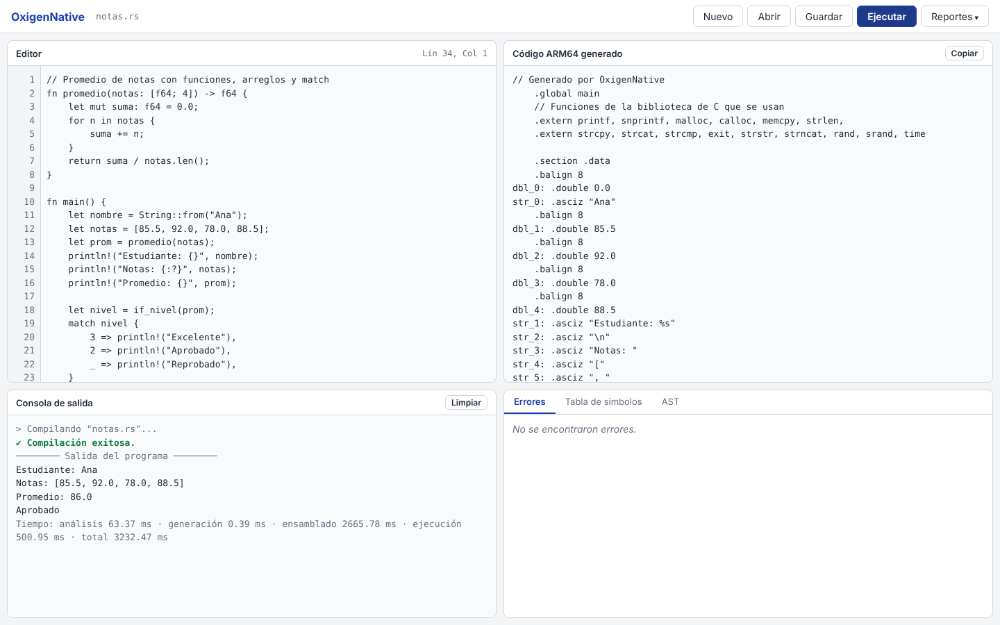

# OxigenNative

Compilador del lenguaje **OxigenNative** (sintaxis inspirada en Rust) a ensamblador **ARM64 (AArch64)**, con ejecución en **QEMU User Mode** e interfaz web en **Django**.

Proyecto 2 — Organización de Lenguajes y Compiladores 2 — Universidad de San Carlos de Guatemala, segundo semestre 2026.



## Qué hace

```
código .rs → léxico → sintáctico → AST → semántico → ARM64 (.s) → gcc -static → qemu-aarch64 → salida
```

- **Análisis léxico y sintáctico** con PLY, con recuperación de errores: reporta todos los errores de una vez (`Se esperaba ';'.`, etc.).
- **Análisis semántico:** tipos, ámbitos, mutabilidad y tabla de símbolos; los errores semánticos no detienen la ejecución.
- **Generación directa de ARM64** (sin código intermedio), con un modelo explícito de stack y heap y la convención de llamadas AArch64.
- **Ejecución real** del binario ARM64 en QEMU.
- **Reportes:** errores y tabla de símbolos en HTML, y el AST con Graphviz.
- **Interfaz web:** editor con números de línea, consola, código ARM64 generado y reportes en pestañas.

Lenguaje soportado: `i32`, `f64`, `bool`, `char`, `String`, arreglos de N dimensiones `[T; N]`, slices, `if / else if / else`, `while`, `loop`, `for`, `match`, `break` y `continue` con etiquetas, funciones con recursión, `println!` y las funciones embebidas `len`, `contains`, `replace`, `split`, `to_uppercase`, `to_lowercase`, `reverse`, `typeof` y `random`.

## Inicio rápido

Requiere Linux (en macOS, una máquina virtual de Ubuntu, por ejemplo con OrbStack).

```bash
sudo apt install -y python3 python3-venv build-essential qemu-user graphviz
#   (en x86_64 agregue: gcc-aarch64-linux-gnu)

git clone https://github.com/Vasquez005/OLC2_N_P2_2S2026_202401451.git
cd OLC2_N_P2_2S2026_202401451
python3 -m venv venv && source venv/bin/activate
pip install -r requirements.txt

cd backend
python manage.py runserver 0.0.0.0:8000
```

Abra **http://localhost:8000**.

Desde la terminal: `python compilar.py programa.rs [--asm] [--reportes]`

## Documentación

| Documento | Contenido |
|---|---|
| [Manual de usuario](docs/manual_usuario.md) | Instalación paso a paso, uso de la interfaz, cómo interpretar los reportes, ejemplos de sesión y referencia del lenguaje |
| [Manual técnico](docs/manual_tecnico.md) | Arquitectura, gramática formal, AST, análisis semántico, generación de ARM64, decisiones de diseño y desafíos |
| [Diagrama de clases del compilador](docs/diagramas/clases_compilador.png) · [del AST](docs/diagramas/clases_ast.png) | Clases y sus relaciones |
| [Diagrama de flujo de procesamiento](docs/diagramas/flujo_procesamiento.png) · [de la tabla de símbolos](docs/diagramas/flujo_tabla_simbolos.png) | Fases del compilador y funcionamiento de la tabla de símbolos |

## Estructura

```
compiler/      lexer, parser, AST, semántico, tabla de símbolos, generador ARM64, runner, reportes
backend/       proyecto Django: API REST e interfaz web
tests/         programas de prueba (.rs) y scripts por fase
docs/          manuales, diagramas, capturas y ejemplos
compilar.py    compilar y ejecutar desde la terminal
```

## Tecnologías

Python 3 · PLY · Django · Graphviz · GNU gcc/as (AArch64) · QEMU User Mode · Linux
