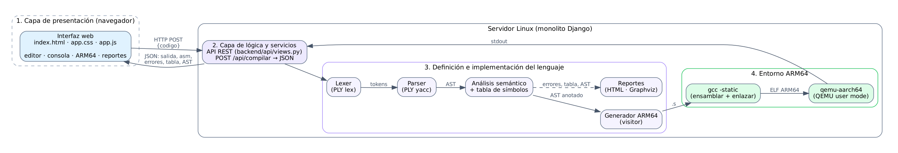
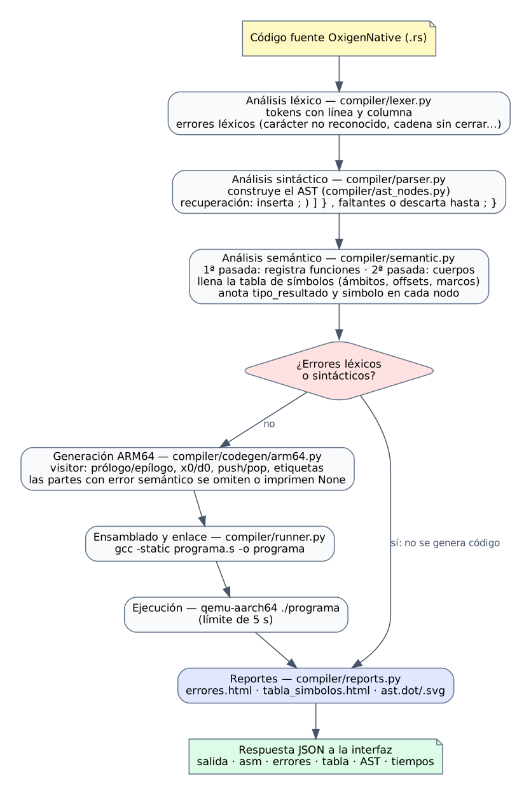
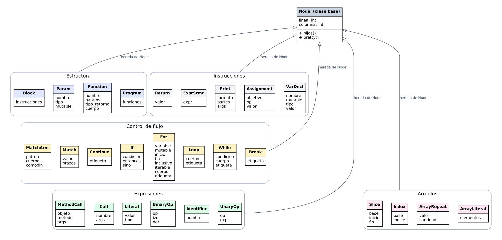
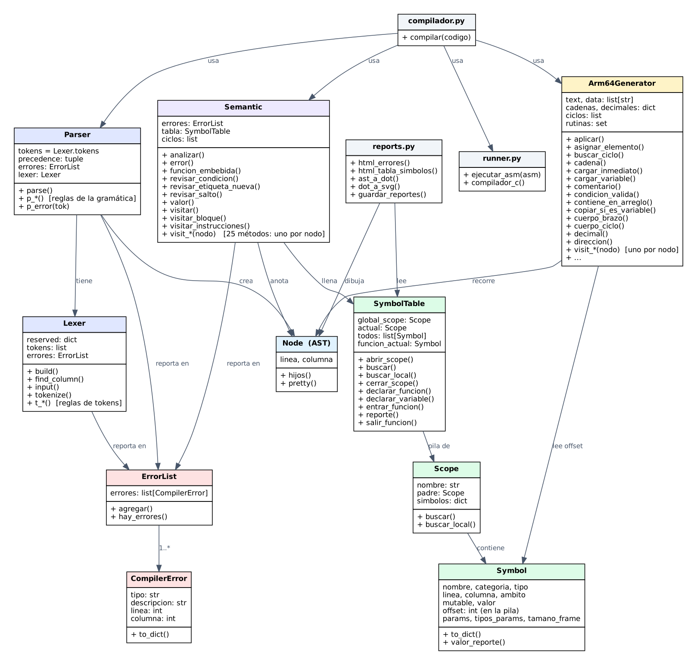
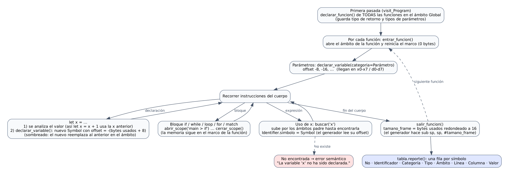

# Manual técnico — OxigenNative

Compilador del lenguaje **OxigenNative** (sintaxis inspirada en Rust) a ensamblador **ARM64 (AArch64)**, con ejecución en **QEMU User Mode** e interfaz web en **Django**.

Proyecto 2 — Organización de Lenguajes y Compiladores 2, segundo semestre 2026.

---

## Contenido

1. [Arquitectura](#1-arquitectura)
2. [Estructura del repositorio](#2-estructura-del-repositorio)
3. [Flujo de procesamiento](#3-flujo-de-procesamiento)
4. [Análisis léxico](#4-análisis-léxico)
5. [Gramática formal](#5-gramática-formal)
6. [Árbol de sintaxis abstracta (AST)](#6-árbol-de-sintaxis-abstracta-ast)
7. [Análisis semántico y tabla de símbolos](#7-análisis-semántico-y-tabla-de-símbolos)
8. [Generación de código ARM64](#8-generación-de-código-arm64)
9. [Ensamblado, enlace y ejecución](#9-ensamblado-enlace-y-ejecución)
10. [Manejo de errores](#10-manejo-de-errores)
11. [Reportes](#11-reportes)
12. [API REST e interfaz](#12-api-rest-e-interfaz)
13. [Decisiones de diseño y desafíos](#13-decisiones-de-diseño-y-desafíos)
14. [Pruebas](#14-pruebas)
15. [Alcance y limitaciones](#15-alcance-y-limitaciones)

---

## 1. Arquitectura

La aplicación es un **monolito cliente/servidor** con los cuatro componentes de la sección 3.1.1 del enunciado. Todos se despliegan en un único servidor Linux, pero cada uno tiene una responsabilidad separada.



| Componente | Implementación | Responsabilidad |
|---|---|---|
| 1. Presentación | `backend/api/templates/api/index.html`, `static/api/app.js`, `app.css` | Editor, consola, panel ARM64 y reportes en el navegador |
| 2. Lógica y servicios | `backend/api/views.py` (Django) | API REST: recibe el código en JSON, coordina las fases y responde en JSON |
| 3. Definición del lenguaje | `compiler/` (PLY + clases propias) | Lexer, parser, AST, semántico, generador ARM64 y reportes |
| 4. Entorno ARM64 | `compiler/runner.py` + `gcc` + `qemu-aarch64` | Ensamblar, enlazar y ejecutar el binario ARM64 |

**Tecnologías:** Python 3, PLY 3.11 (Python Lex-Yacc), Django, Graphviz, GNU `gcc`/`as` para AArch64, QEMU User Mode y Linux (Ubuntu 26.04 ARM64 en OrbStack sobre macOS durante el desarrollo).

---

## 2. Estructura del repositorio

```
OLC2_N_P2_2S2026/
├── compiler/                 # El compilador (independiente de Django)
│   ├── lexer.py              # Análisis léxico (PLY lex)
│   ├── parser.py             # Análisis sintáctico (PLY yacc) + recuperación de errores
│   ├── ast_nodes.py          # Clases del AST
│   ├── semantic.py           # Análisis semántico (visitor)
│   ├── symbol_table.py       # Tabla de símbolos: Symbol, Scope, SymbolTable
│   ├── tipos.py              # Utilidades para tipos de arreglo
│   ├── errors.py             # CompilerError y ErrorList (compartidos por todas las fases)
│   ├── codegen/arm64.py      # Generador de código ARM64 (visitor) + rutinas de apoyo
│   ├── runner.py             # gcc -static + qemu-aarch64
│   ├── compilador.py         # compilar(codigo): une todas las fases
│   └── reports.py            # Reportes HTML y Graphviz
├── backend/                  # Proyecto Django
│   ├── backend/settings.py   # Agrega la raíz del repositorio al path de Python
│   ├── backend/urls.py       # /  y  /api/
│   └── api/                  # Vistas, rutas, plantilla y archivos estáticos de la interfaz
├── tests/                    # Programas de prueba (.rs) y scripts de prueba por fase
├── docs/                     # Esta documentación, diagramas, capturas y ejemplos
├── compilar.py               # Compilar y ejecutar desde la terminal
└── build/                    # (generado) último .s y reportes
```

---

## 3. Flujo de procesamiento



La función `compilar(codigo)` de `compiler/compilador.py` ejecuta las fases en orden. Cada fase consume la salida de la anterior:

1. **Léxico y sintáctico** (`Parser(errores).parse(codigo)`): produce el AST. El parser pide los tokens al lexer bajo demanda.
2. **Semántico** (`Semantic(errores).analizar(arbol)`): llena la tabla de símbolos y **anota** el AST. A cada expresión le agrega `tipo_resultado`, y a cada uso de variable, el `simbolo` al que se refiere.
3. **Decisión:** si hubo errores léxicos o sintácticos, el árbol puede estar incompleto y **no se genera código**. Los errores semánticos **no** detienen la generación: las partes inválidas se omiten o se imprimen como `None` (resiliencia, sección 3.5.1).
4. **Generación ARM64** (`Arm64Generator().generar(arbol)`): produce el texto del archivo `.s`.
5. **Ensamblado, enlace y ejecución** (`ejecutar_asm(asm)`): `gcc -static` y luego `qemu-aarch64`, con un límite de 5 segundos.
6. **Reportes** (`reports.py`): HTML de errores y de la tabla de símbolos, y el AST en DOT/SVG.

`compilar()` devuelve un diccionario con `errores`, `tabla`, `ast`, `asm`, `salida`, `error_ejecucion` y `tiempos` (milisegundos por fase).

---

## 4. Análisis léxico

Archivo: `compiler/lexer.py`. Se implementa con `ply.lex` como **clase**, para que cada compilación tenga su propio lexer y su propia lista de errores. Esto importa porque el servidor puede atender varias peticiones a la vez.

### 4.1 Tokens

| Categoría | Tokens |
|---|---|
| Palabras reservadas | `fn let mut if else while loop for in match break continue return true false struct` |
| Tipos | `i32 f64 bool char String` |
| Literales | entero `\d+`, decimal `\d+\.\d+`, cadena `"..."`, raw string `r"..."` y `r#"..."#`, cadena con comillas tipográficas `“...”`, carácter `'a'` |
| Identificadores | `[A-Za-z_][A-Za-z0-9_]*` (sensible a mayúsculas); `_` solo es el comodín del `match` |
| Etiquetas | `'outer` (para `break 'outer`) |
| Aritméticos | `+ - * / %` |
| Asignación | `= += -= *= /= %=` |
| Relacionales | `== != > >= < <=` |
| Lógicos | `&& \|\| !` |
| Otros | `( ) { } [ ] ; , : :: . .. ..= -> => &` y la macro `println!` |

### 4.2 Detalles importantes

- **El orden de las reglas importa.** PLY prueba las reglas escritas como funciones en el orden en que aparecen, y las escritas como cadenas, de la más larga a la más corta. Por eso los comentarios van antes que `/`, los raw strings antes que `ID`, `CHAR` antes que `LABEL` (si no, `'a'` sería una etiqueta) y `FLOAT` antes que `INT`. `FLOAT` exige dígitos a ambos lados del punto para que `1..4` se lea como `1`, `..` y `4`.
- **Palabras reservadas:** todo se reconoce como `ID` y luego se busca en el diccionario `reserved`.
- **Comentarios** `//` y `/* */`: se descartan. Uno de bloque sin cerrar es un error léxico (sección 3.2.2).
- **Secuencias de escape** en cadenas y caracteres: `\n \t \r \0 \\ \" \'`. Las raw strings no las procesan.
- **Línea y columna:** cada token guarda su línea; la columna se calcula con `find_column(lexpos)`.

### 4.3 Errores léxicos

| Situación | Mensaje |
|---|---|
| Carácter que no pertenece al lenguaje | `Carácter no reconocido '@'.` |
| Cadena sin comilla de cierre | `Cadena sin cerrar: se esperaba '"'.` |
| Comentario `/*` sin `*/` | `Comentario de bloque sin cierre: se esperaba '*/'.` |
| Escape desconocido (`\q`) | `Secuencia de escape no válida '\q'.` |

Después de un error léxico el lexer **sigue analizando** (`t.lexer.skip(1)`).

---

## 5. Gramática formal

Archivo: `compiler/parser.py`. La gramática se escribe en los docstrings de los métodos `p_*` (formato de `ply.yacc`, LALR(1)), y cada método construye el nodo correspondiente del AST.

La gramática de abajo se **generó automáticamente** a partir de las producciones del parser con `python docs/generar_gramatica.py`, así que coincide exactamente con el código. Convenciones: `<x>` es un no terminal, `'x'` es un token tal como se escribe, `<id>`, `<entero>`, `<decimal>`, `<cadena>`, `<caracter>` y `<etiqueta>` son literales léxicos, `ε` es la cadena vacía, y `error` es el token especial de PLY para recuperarse de errores (sección 10.2).

```bnf
<programa> ::= <funciones>

<funciones> ::= <funciones> <funcion>
              | <funcion>

<funcion> ::= 'fn' <id> '(' <parametros_opt> ')' <retorno_opt> <bloque>

<parametros_opt> ::= <parametros>
                   | ε

<parametros> ::= <parametros> ',' <parametro>
               | <parametro>

<parametro> ::= <mut_opt> <id> ':' <tipo>

<retorno_opt> ::= '->' <tipo>
                | ε

<bloque> ::= '{' <instrucciones> '}'
           | '{' error '}'
           | '{' '}'

<instrucciones> ::= <instrucciones> <instruccion>
                  | <instruccion>

<instruccion> ::= <declaracion> ';'
                | <asignacion> ';'
                | <impresion> ';'
                | <sentencia_if>
                | <sentencia_while>
                | <sentencia_loop>
                | <sentencia_match>
                | <sentencia_for>
                | <sentencia_break> ';'
                | <sentencia_continue> ';'
                | <sentencia_return> ';'
                | <expresion> ';'
                | error ';'
                | ';'

<sentencia_return> ::= 'return' <expresion>
                     | 'return'

<sentencia_if> ::= 'if' <expresion> <bloque>
                 | 'if' <expresion> <bloque> 'else' <bloque>
                 | 'if' <expresion> <bloque> 'else' <sentencia_if>

<sentencia_while> ::= 'while' <expresion> <bloque>
                    | <etiqueta> ':' 'while' <expresion> <bloque>

<sentencia_loop> ::= 'loop' <bloque>
                   | <etiqueta> ':' 'loop' <bloque>

<sentencia_for> ::= 'for' <mut_opt> <id> 'in' <iterable> <bloque>
                  | <etiqueta> ':' 'for' <mut_opt> <id> 'in' <iterable> <bloque>

<iterable> ::= <expresion> '..' <expresion>
             | <expresion> '..=' <expresion>
             | <expresion>

<sentencia_match> ::= 'match' <expresion> '{' <brazos> '}'
                    | 'match' <expresion> '{' <brazos> <brazo_final> '}'
                    | 'match' <expresion> '{' <brazo_final> '}'

<brazos> ::= <brazos> <brazo>
           | <brazo>

<brazo> ::= <patron> '=>' <bloque>
          | <patron> '=>' <bloque> ','
          | <patron> '=>' <instruccion_brazo> ','

<brazo_final> ::= <patron> '=>' <instruccion_brazo>

<instruccion_brazo> ::= <impresion>
                      | <asignacion>
                      | <sentencia_break>
                      | <sentencia_continue>
                      | <sentencia_return>
                      | <expresion>

<patron> ::= <entero>
           | <decimal>
           | <caracter>
           | <cadena>
           | 'true'
           | 'false'
           | '-' <entero>
           | '-' <decimal>
           | '_'

<sentencia_break> ::= 'break'
                    | 'break' <etiqueta>

<sentencia_continue> ::= 'continue'
                       | 'continue' <etiqueta>

<declaracion> ::= 'let' <mut_opt> <id> <tipo_opt> <init_opt>

<mut_opt> ::= 'mut'
            | ε

<tipo_opt> ::= ':' <tipo>
             | ε

<init_opt> ::= '=' <expresion>
             | ε

<asignacion> ::= <primario> '=' <expresion>
               | <primario> '+=' <expresion>
               | <primario> '-=' <expresion>
               | <primario> '*=' <expresion>
               | <primario> '/=' <expresion>
               | <primario> '%=' <expresion>

<impresion> ::= 'println!' '(' ')'
              | 'println!' '(' <expresion> ')'
              | 'println!' '(' <expresion> ',' <lista_expresiones> ')'

<lista_expresiones> ::= <lista_expresiones> ',' <expresion>
                      | <expresion>

<tipo> ::= 'i32'
         | 'f64'
         | 'bool'
         | 'char'
         | 'String'
         | <id> '<' <tipo> '>'
         | '&' <id>
         | '[' <tipo> ';' <entero> ']'

<expresion> ::= <expresion> '||' <expresion>
              | <expresion> '&&' <expresion>
              | <expresion> '==' <expresion>
              | <expresion> '!=' <expresion>
              | <expresion> '<' <expresion>
              | <expresion> '>' <expresion>
              | <expresion> '<=' <expresion>
              | <expresion> '>=' <expresion>
              | <expresion> '+' <expresion>
              | <expresion> '-' <expresion>
              | <expresion> '*' <expresion>
              | <expresion> '/' <expresion>
              | <expresion> '%' <expresion>
              | '!' <expresion>
              | '-' <expresion>
              | '(' <expresion> ')'
              | <primario>

<primario> ::= <entero>
             | <decimal>
             | 'true'
             | 'false'
             | <caracter>
             | <cadena>
             | 'String' '::' <id> '(' <cadena> ')'
             | 'String' '::' <id> '(' ')'
             | <id>
             | '[' <lista_expresiones> ']'
             | '[' <expresion> ';' <entero> ']'
             | <primario> '[' <expresion> ']'
             | '&' <primario> '[' <expresion> '..' <expresion> ']'
             | <primario> '.' <id> '(' <lista_expresiones> ')'
             | <primario> '.' <id> '(' ')'
             | <id> '(' <lista_expresiones> ')'
             | <id> '(' ')'

```

### 5.1 Precedencia y asociatividad

La regla de `<expresion>` es ambigua a propósito: una sola regla cubre todos los operadores binarios, y la tabla `precedence` de PLY resuelve cómo agrupar. De **menor a mayor** prioridad:

| Nivel | Operadores | Asociatividad |
|---|---|---|
| 1 | `\|\|` | izquierda |
| 2 | `&&` | izquierda |
| 3 | `== != < > <= >=` | no asociativos (`a < b < c` es error, como en Rust) |
| 4 | `+ -` | izquierda |
| 5 | `* / %` | izquierda |
| 6 | `!` y menos unario | derecha |

El menos unario usa el token ficticio `UMINUS` con `%prec`, para tener más prioridad que la resta: `-a + 5` es `(-a) + 5`.

### 5.2 Notas sobre la gramática

- `else if` no es una construcción aparte: es un `<sentencia_if>` en la rama del `else` (sección 3.3.8).
- No hay ambigüedad de "else colgante", porque los bloques siempre llevan llaves.
- **Paréntesis en condiciones:** el enunciado los prohíbe alrededor de toda la condición. La regla `'(' <expresion> ')'` marca el nodo con `_parentesis`, e `if`/`while` reportan el error si su condición completa trae esa marca. `if (a) && (b)` es válido.
- **`println!`** acepta tres formas: `println!()`, `println!(valor)` y `println!("formato {}", valores)`. Para distinguir si el primer argumento es la cadena de formato, el parser marca con `_cadena_directa` los literales escritos tal cual.
- **Asignación:** el lado izquierdo es un `<primario>`. El parser verifica que sea una variable o un acceso a arreglo (`m[i][j] = 7`).
- **`match`:** la coma es obligatoria después de un brazo sin llaves, salvo en el último, como en Rust.
- **Tipos:** `[T; N]` es recursivo (`[[i32; 3]; 2]`); `Vec<T>` y `&str` se aceptan para los arreglos dinámicos que devuelve `split`.
- **La gramática no tiene conflictos** shift/reduce ni reduce/reduce (se verifica con `python -m tests.prueba_parser archivo.rs --debug`, que escribe `parser.out`).

---

## 6. Árbol de sintaxis abstracta (AST)

Archivo: `compiler/ast_nodes.py`. PLY no construye el árbol: cada clase la definimos nosotros, y todas heredan de `Node`, que guarda `linea` y `columna` para los mensajes de error.



`Node.hijos()` devuelve los atributos de un nodo (excepto la posición y los que empiezan con `_`). Lo usan el reporte Graphviz y los scripts de prueba para recorrer **cualquier** nodo de forma genérica, así los nodos nuevos aparecen en el reporte sin código adicional.

Decisiones del modelado:

| Construcción | Representación |
|---|---|
| `a[i][j]` | `Index(Index(a, i), j)` |
| `x += 5` | `Assignment(objetivo=Identifier(x), op='+=', valor=5)`; se trata como `x = x + 5` |
| `println!("a = {}, b = {}", a, b)` | `Print(partes=['a = ', None, ', b = ', None], args=[a, b])`: el formato se separa **una sola vez** en el parser |
| `saludar(10);` | `ExprStmt(Call(...))`: una expresión usada como instrucción |
| `typeof(x)`, `random(a, b)` | `Call` con nombre reservado; el semántico los reconoce como funciones embebidas |
| `texto.len()` | `MethodCall(objeto, 'len', [])` |

El semántico agrega atributos a los nodos (`tipo_resultado`, `simbolo`, `omitir`, `usar_defecto`...). El generador los lee y no vuelve a decidir nada.

---

## 7. Análisis semántico y tabla de símbolos

### 7.1 Diagrama de clases del compilador



### 7.2 Patrón visitor

`Semantic.visitar(nodo)` llama a `visit_<Clase>`: un `While` va a `visit_While`, un `BinaryOp` a `visit_BinaryOp`. Las expresiones **devuelven su tipo** y además lo anotan en el nodo. El generador de ARM64 usa el mismo patrón.

### 7.3 Tabla de símbolos

Archivo: `compiler/symbol_table.py`.

- **`Symbol`**: nombre, categoría (Variable, Parámetro o Función), tipo, línea, columna, ámbito, si es `mut`, valor inicial (para el reporte) y, sobre todo, su **`offset`** en el marco de pila (`[x29, #offset]`). Las funciones guardan además sus parámetros y el tamaño de su marco.
- **`Scope`**: un ámbito, es decir, un diccionario `nombre → Symbol` más un puntero al ámbito padre. `buscar()` sube por los padres.
- **`SymbolTable`**: la pila de ámbitos y la lista `todos`, con cada símbolo declarado, para el reporte.



Reglas principales:

1. **Dos pasadas.** Primero se registran todas las funciones (con sus tipos de parámetros), y después se analizan los cuerpos. Así se puede llamar a una función definida más abajo.
2. **Cada bloque abre un ámbito** (`main > while > if`). Las variables de un bloque interno solo son visibles ahí, pero **su memoria sigue en el marco de la función**.
3. **Offsets:** cada variable recibe 8 bytes (`-8`, `-16`, ...). Al terminar la función, el total se redondea a múltiplo de 16 porque ARM64 exige `sp` alineado a 16. Ese valor es `tamano_frame`.
4. **Sombreado:** `let x` repetido crea un símbolo **nuevo**, con su propio offset y quizá otro tipo. El valor se analiza **antes** de declarar, así `let x = x + 0.5;` usa la `x` anterior.
5. **Valores por defecto** (sección 3.2.3): una variable declarada sin valor recibe `0`, `0.0`, `false`, `'\0'`, `""` o un arreglo de ceros.

### 7.4 Sistema de tipos

Las tablas de tipos resultantes de las secciones 3.3.5 a 3.3.7 están en `semantic.py` como diccionarios `(tipo_izq, tipo_der) → tipo_resultado`. Si una combinación no está en la tabla, la operación es inválida.

| Operación | Combinaciones válidas → resultado |
|---|---|
| `+` | i32+i32→i32 · i32/f64 mezclados→f64 · String+String→String (concatenación) |
| `- / %` | i32 con i32→i32 · i32/f64 mezclados→f64 |
| `*` | lo de `-` y además i32*String o String*i32→String (repetición: `3 * "ab"` = `"ababab"`) |
| `== != < > <= >=` | números entre sí, char con char o con i32, bool con bool, String con String → bool |
| `&& \|\| !` | solo bool → bool |
| `-x` | i32 o f64 |

**Promoción** `i32 → f64`: en operaciones mixtas, en asignaciones (`let r: f64 = 7;`), en argumentos y en `return`. El generador inserta `scvtf` donde haga falta.

### 7.5 Validaciones semánticas

Variable o función no declarada; tipos incompatibles en asignación, operación, argumento o retorno; modificar una variable inmutable (incluidos los elementos de un arreglo y `reverse()`); condición que no es `bool`; `break` o `continue` fuera de un ciclo, o con etiqueta inexistente; número incorrecto de argumentos; función sin `return` o que retorna un valor sin tener tipo de retorno; usar como valor una función sin retorno; número de `{}` distinto al de argumentos en `println!`; índice constante fuera de los límites; elementos de distinto tipo en un arreglo; `match` sin comodín, o con el comodín antes del final; división entre la constante 0; literal fuera del rango de `i32`.

### 7.6 Resiliencia

Un error semántico **no** detiene el análisis ni la ejecución (sección 3.5.1):

- Una expresión inválida recibe el tipo `'None'`. Ese tipo se propaga **sin generar más errores**: si `a + nombre` ya falló, `(a + nombre) * 2` no vuelve a reportar. Si se imprime, el programa muestra `None`, como en el ejemplo de la sección 3.3.5.
- Una instrucción inválida se marca con `omitir = True` y el generador la salta.

---

## 8. Generación de código ARM64

Archivo: `compiler/codegen/arm64.py`. Es un visitor que recorre el AST **ya anotado** y escribe ensamblador GNU para AArch64. No hay representación intermedia (sección 3.1.3): cada nodo se traduce directamente a instrucciones.

### 8.1 Convenciones del generador

| Convención | Detalle |
|---|---|
| Resultado de una expresión | `x0` para i32, bool, char, String (puntero) y arreglos (puntero); `d0` para f64 |
| Variables | En la pila, en `[x29, #offset]` (el offset lo decidió la tabla de símbolos) |
| Temporales | `push`/`pop` en la pila (16 bytes por valor para mantener `sp` alineado) |
| `bool` | `0` o `1` (`cset`) |
| `char` | Código Unicode del carácter |
| Texto constante | En `.data` con `.asciz`, **una sola vez** por texto distinto |
| `f64` constante | En `.data` con `.double`, precedido de `.balign 8` |
| Etiquetas internas | `.L<nombre>_<n>`: únicas y locales al archivo |
| Funciones del usuario | `fn_<nombre>` (para no chocar con funciones de la biblioteca de C); `main` se llama `main` |

**Registros usados** (sección 3.4.2): `x0`–`x7` y `d0`–`d7` para parámetros y resultados; `x9`–`x12` como auxiliares; `x19`–`x24` solo dentro de las rutinas de apoyo, que los guardan y restauran (son *callee-saved*); `x29` es el *frame pointer*, `x30` el *link register* y `sp` el *stack pointer*.

### 8.2 Modelo de memoria

**Stack** (sección 3.1.3): cada función tiene su marco.

```asm
fn_ejemplo:
    stp x29, x30, [sp, #-16]!   // prólogo: guardar marco anterior y dirección de retorno
    mov x29, sp                 // x29 = base del marco
    sub sp, sp, #32             // espacio para las variables (tamano_frame)
    str x0, [x29, #-8]          // copiar los parámetros a su lugar
    ...
.Lfin_ejemplo:                  // aquí saltan los return
    mov sp, x29                 // epílogo: liberar variables
    ldp x29, x30, [sp], #16     // restaurar marco y retorno
    ret
```

`main` es una función normal que termina con `mov w0, #0` y `ret`, **no** con la llamada al sistema `exit`. Así la biblioteca de C vacía el búfer de `printf` antes de salir. Además, al iniciar `main` llama a `setvbuf(stdout, NULL, _IOLBF, 0)` para que la salida se escriba **línea por línea**: si la ejecución se corta (ciclo infinito o índice fuera de rango), lo que ya se imprimió no se pierde.

**Heap:** las cadenas creadas en ejecución (concatenar, repetir, `replace`, `to_uppercase`, `split`) y **todos los arreglos** se reservan con `malloc`/`calloc`. La variable guarda el puntero.

### 8.3 Expresiones

Patrón general para `izq op der`:

```asm
    <evaluar izq>         // queda en x0 (o d0)
    str x0, [sp, #-16]!   // push
    <evaluar der>         // queda en x0 (o d0)
    ldr x1, [sp], #16     // pop: x1 = izq
    add w0, w1, w0        // x0 = izq op der
```

Como cada lado guarda su valor en la pila, funciona con cualquier anidación. La función `aplicar(op, tipo_izq, tipo_der)` elige el código según los tipos, con las mismas reglas del semántico:

| Caso | Instrucciones |
|---|---|
| Enteros | `add sub mul sdiv` sobre registros `w` (32 bits, el desbordamiento da la vuelta como un i32 real) + `sxtw`. Módulo: `sdiv` + `msub` (`a - (a/b)*b`) |
| f64 | `fadd fsub fmul fdiv`; módulo: `fdiv` + `frintz` + `fmsub`; `scvtf` para promover el lado i32 |
| Comparaciones | `cmp` + `cset` (enteros); `fcmp` + `cset` con `mi`/`ls` para que una comparación con NaN dé false |
| String | `strcmp` (comparar), `__oxi_concat` (+), `__oxi_repetir` (*) |
| `&&` / `\|\|` | **Cortocircuito con saltos** (sección 3.3.7): `cbz`/`cbnz` saltan al final sin evaluar el lado derecho |
| `!x` | `eor x0, x0, #1` |
| `-x` | `neg w0, w0` o `fneg d0, d0` |

### 8.4 Control de flujo (sección 3.4.5)

En ensamblador solo hay etiquetas y saltos:

```asm
// while c { A }
.Lwhile_inicio_2:             // aquí salta continue
    <evaluar c>               // x0 = 1 o 0
    cbz x0, .Lwhile_fin_3     // c es false: salir
    <A>
    b .Lwhile_inicio_2
.Lwhile_fin_3:                // aquí salta break
```

- `if/else`: `cbz` salta al `else` (o al final). El `else if` es un `If` dentro del `else`.
- `loop`: igual que `while`, sin condición.
- `for i in a..b`: el valor actual y el fin se guardan en la pila; `..=` usa `b.gt` en lugar de `b.ge`. `for x in arreglo` recorre con un índice.
- `match`: el valor se evalúa una vez y se compara con cada patrón usando la misma `aplicar('==')`. El valor se saca de la pila **antes** del cuerpo de cada brazo, para que un `break` dentro del brazo no deje la pila desbalanceada.
- `break`/`continue`: una **pila de ciclos activos** guarda las etiquetas de inicio y fin de cada ciclo. Sin etiqueta se usa el más interno; con `'outer` se busca por nombre.

### 8.5 Funciones (sección 3.1.3, convención AArch64)

- Argumentos enteros, booleanos, chars, Strings y arreglos (punteros) en `x0`–`x7`; `f64` en `d0`–`d7`, **con contadores separados**: `f(a: i32, x: f64, b: i32)` usa `x0, d0, x1`. La función `registros_parametros()` calcula esto, y la usan tanto quien llama como la función llamada.
- Al llamar se evalúan y apilan **todos** los argumentos primero, y después se sacan a sus registros. Si no, evaluar `f(g(1), g(2))` borraría `x0` antes de usarlo.
- `bl fn_nombre` guarda la dirección de retorno en `x30`; el resultado vuelve en `x0` o `d0`.
- **Recursión:** cada llamada crea su propio marco, así que cada `factorial(n)` tiene su propia `n`. Por eso las variables viven en la pila y no en `.data`.

### 8.6 Arreglos

**Estrategia: row-major** (sección 3.3.10). Un arreglo de cualquier número de dimensiones es **un solo bloque contiguo** en el heap, con 8 bytes por valor.

```
let m: [[i32; 3]; 2] = [[1, 2, 3], [4, 5, 6]];
memoria:  1 2 3 4 5 6
m[i][j] está en  base + (i * 3 + j) * 8
```

**Justificación:** es el orden de C, C++ y Rust; el literal se escribe fila por fila en el mismo orden en que se lee; y `m[i]` es simplemente la dirección donde empieza la fila `i`. Así el mismo código (`direccion_elemento`) sirve para 2, 3 o N dimensiones: calcula la dirección de la fila y le suma el desplazamiento de la columna. También se aprovecha mejor la caché al recorrer por filas.

- **Límites:** con índice constante los revisa el semántico. Con índice variable, el generador inserta `cmp` + `b.lo`, una comparación **sin signo** en la que un índice negativo se ve como un número enorme, así una sola instrucción revisa `0 <= i < n`. Si falla, `__oxi_fuera_limites` imprime el error con línea y columna y termina el programa.
- **Copia:** `let b = a;` y pasar un arreglo a una función crean una copia (`__oxi_copiar` = `malloc` + `memcpy`), como en Rust.
- **Arreglos dinámicos** (`[String]`, resultado de `split`): el largo solo se conoce al ejecutar, así que el bloque lo guarda al inicio: `[ largo | e0 | e1 | ... ]`.
- **Slices** `&a[i..j]`: crean un arreglo nuevo con una copia de esos elementos.

### 8.7 `println!` y la biblioteca de C

Se enlaza con la biblioteca de C (`.extern printf`), igual que el ejemplo del auxiliar. Cada `println!` se traduce en un `printf` **por cada marcador** `{}`, más uno final con `\n`. Así no hay límite en la cantidad de argumentos. El especificador depende del tipo: `%d` (i32), `%s` (String y bool con `"true"`/`"false"`), y `%s` sobre el texto que preparan `__oxi_f64_str` (f64, con `.0` si es entero) y `__oxi_char_str` (char en UTF-8). Los arreglos se imprimen con un ciclo en ensamblador como `[a, b, c]`.

### 8.8 Rutinas de apoyo

Funciones escritas en ensamblador que se agregan al `.s` **solo si el programa las usa**:

| Rutina | Uso |
|---|---|
| `__oxi_f64_str` | f64 → texto (`snprintf` con `%.1f` o `%.15g`) |
| `__oxi_char_str` | char → texto UTF-8 (1 a 4 bytes) |
| `__oxi_concat`, `__oxi_repetir` | `String + String`, `n * String` |
| `__oxi_replace` | `texto.replace(a, b)` |
| `__oxi_mayusculas` | `to_uppercase` / `to_lowercase`, incluidas tildes y ñ (UTF-8 `C3 xx`) |
| `__oxi_split`, `__oxi_split_ws`, `__oxi_subcadena` | `split(sep)`, `split_whitespace()` |
| `__oxi_invertir` | `arreglo.reverse()` |
| `__oxi_copiar` | copia de arreglos |
| `__oxi_random` | `random(min, max)` con `rand()` y semilla `srand(time(0))` |
| `__oxi_fuera_limites` | error de ejecución por índice fuera de rango |

### 8.9 Ejemplo de entrada y salida (sección 3.4.7)

Entrada (`docs/ejemplos/cuadrado.rs`):

```rust
fn cuadrado(n: i32) -> i32 {
    return n * n;
}

fn main() {
    let x = cuadrado(4);
    if x > 10 {
        println!("x = {}", x);
    }
}
```

Salida del compilador (fragmento de `docs/ejemplos/cuadrado.s`, generado tal cual):

```asm
fn_cuadrado:
    stp x29, x30, [sp, #-16]!           // guardar x29 (marco) y x30 (retorno)
    mov x29, sp                         // x29 = base del nuevo marco
    sub sp, sp, #16                     // espacio para variables (16 bytes)
    str x0, [x29, #-8]                  // parámetro n = x0
    ldr x0, [x29, #-8]                  // x0 = n
    str x0, [sp, #-16]!                 // push x0
    ldr x0, [x29, #-8]                  // x0 = n
    ldr x1, [sp], #16                   // pop x1
    mul w0, w1, w0
    sxtw x0, w0                         // extender el signo a 64 bits
    b .Lfin_cuadrado_1                  // return  (línea 2)
    mov x0, #0                          // 0 / false / '\0'
.Lfin_cuadrado_1:
    mov sp, x29                         // liberar las variables
    ldp x29, x30, [sp], #16             // restaurar marco y retorno
    ret

main:
    stp x29, x30, [sp, #-16]!
    mov x29, sp
    sub sp, sp, #16
    adrp x0, stdout                     // setvbuf(stdout, NULL, _IOLBF, 0):
    ldr x0, [x0, :lo12:stdout]          // la salida se escribe línea por línea
    mov x1, #0
    mov x2, #1
    mov x3, #0
    bl setvbuf
    // llamada a cuadrado()  (línea 6)
    mov x0, #4
    str x0, [sp, #-16]!                 // push x0
    ldr x0, [sp], #16                   // pop x0 (primer argumento)
    bl fn_cuadrado
    str x0, [x29, #-8]                  // x = x0
    // if  (línea 7)
    ldr x0, [x29, #-8]                  // x0 = x
    str x0, [sp, #-16]!                 // push x0
    mov x0, #10
    ldr x1, [sp], #16                   // pop x1
    cmp x1, x0
    cset x0, gt                         // x0 = (x > 10) ? 1 : 0
    cbz x0, .Lif_fin_4                  // condición false -> saltar
    // println!  (línea 8)
    ldr x0, [x29, #-8]
    mov x1, x0                          // x1 = valor a imprimir
    adrp x0, str_0                      // x0 = "x = %d"
    add x0, x0, :lo12:str_0
    bl printf
    adrp x0, str_1                      // x0 = "\n"
    add x0, x0, :lo12:str_1
    bl printf
.Lif_fin_4:
.Lfin_main_2:
    mov w0, #0                          // return 0
    mov sp, x29
    ldp x29, x30, [sp], #16
    ret
```

Ejecución en QEMU: `x = 16`.

---

## 9. Ensamblado, enlace y ejecución

Archivo: `compiler/runner.py`.

```bash
gcc -static programa.s -o programa      # ensamblar + enlazar con la biblioteca de C
qemu-aarch64 ./programa                 # ejecutar en QEMU User Mode
```

- Se usa `gcc` (y no `as` + `ld`) porque el programa llama a `printf`, `malloc`, etc. `-static` mete la biblioteca dentro del ejecutable, así QEMU no necesita buscarla.
- El compilador se elige automáticamente: `gcc` en Linux ARM64 y `aarch64-linux-gnu-gcc` (compilador cruzado) en Linux x86_64. Se puede forzar con la variable de entorno `OXIGEN_GCC`.
- Cada compilación usa su **propia carpeta temporal**, para que dos peticiones simultáneas no se pisen. Una copia del último `.s` queda en `build/programa.s`.
- **Límite de 5 segundos** de ejecución: un ciclo infinito no congela el servidor.
- Se miden los tiempos de ensamblado y de ejecución, y se muestran en la consola.

---

## 10. Manejo de errores

### 10.1 Representación

`compiler/errors.py` define `CompilerError(tipo, descripcion, linea, columna)` y `ErrorList`. **Todas las fases agregan sus errores a la misma lista**, en el formato de la sección 3.5.1:

```
[Error Semántico] Línea 7, Columna 24
No es posible aplicar el operador '+' entre los tipos i32 y String.
```

### 10.2 Recuperación de errores sintácticos

Método `Parser.p_error`. Cuando un token no encaja, PLY permite consultar qué tokens esperaba el parser en ese estado (`parser.action[estado]`):

1. **Inserción del token faltante.** Si faltaba `;`, `)`, `]`, `}` o `,`, se reporta `Se esperaba ';'.` **justo después del token anterior** (la posición del ejemplo del enunciado), se inserta un token sintético y el token que causó el error se vuelve a entregar después (`parser.errok()` + devolver el token). El análisis continúa como si el código estuviera bien escrito, **sin perder la instrucción**, así que no aparecen errores semánticos falsos.
2. **Elección del token.** Hay tres reglas:
   - Se lleva una pila de `(`, `[` y `{` abiertos y se cierra primero el más interno. Esto es necesario porque el parser LALR comparte estados entre `f(a, b)` y `[a, b]`.
   - Después de `;`, `{` o `}` no se inserta `;`.
   - Si el siguiente token empieza un elemento nuevo dentro de `( )`, `[ ]` o un `match`, lo que falta es una coma.
3. **Modo pánico** para cualquier otro error. Se reporta qué se esperaba (`Se esperaba una expresión, pero se encontró '='.`), y PLY descarta tokens hasta poder usar una regla con el token `error`: `<instruccion> ::= error ';'` o `<bloque> ::= '{' error '}'`.

Con esto, un archivo con varios errores los reporta **todos** en una sola ejecución: léxicos, sintácticos y semánticos.

### 10.3 Errores de ejecución

Índice fuera de los límites con índice variable (el programa termina con código 1 y el mensaje con línea y columna), ciclo infinito (límite de 5 s) y fallas de `gcc` o QEMU. Todos se muestran en la consola de la interfaz.

---

## 11. Reportes

Archivo: `compiler/reports.py`. Se generan **automáticamente** en cada compilación (sección 3.5) en `build/reportes/` y también viajan en la respuesta de la API.

| Reporte | Contenido |
|---|---|
| `errores.html` | No., Tipo, Descripción, Línea, Columna y **Fragmento** (la línea de código del error) |
| `tabla_simbolos.html` | No., Identificador, Categoría, Tipo, Ámbito, Línea, Columna y Valor |
| `ast.dot` / `ast.svg` | El AST en formato DOT, convertido a SVG con `dot -Tsvg` |

El reporte del AST recorre el árbol de forma genérica con `Node.hijos()`. Los atributos simples van dentro de la caja, los hijos son flechas con el nombre del atributo, y el tipo calculado por el semántico se muestra como `⟶ tipo`. Colores: azul para la estructura, verde para las expresiones y **rojo para los nodos con error semántico**.

---

## 12. API REST e interfaz

### 12.1 Rutas

| Método y ruta | Descripción |
|---|---|
| `GET /` | Interfaz web |
| `GET /api/` | Estado del servidor |
| `POST /api/compilar` | Compila y ejecuta. Recibe `{"codigo": "..."}` |
| `GET /api/reporte/errores` | Último reporte de errores (HTML) |
| `GET /api/reporte/tabla` | Última tabla de símbolos (HTML) |
| `GET /api/reporte/ast` | Última imagen del AST (SVG) |
| `GET /api/reporte/ast.dot` | Último archivo DOT del AST |

Agregar `?descargar=1` a una ruta de reporte descarga el archivo.

Respuesta de `POST /api/compilar`:

```json
{
  "ok": true,
  "salida": "x = 16\n",
  "error_ejecucion": null,
  "asm": "// Generado por OxigenNative ...",
  "errores": [{"no": 1, "tipo": "Semántico", "descripcion": "...", "linea": 7, "columna": 24, "fragmento": "..."}],
  "tabla": [{"no": 1, "identificador": "main", "categoria": "Función", "tipo": "()", "ambito": "Global", "linea": 1, "columna": 1, "valor": "---"}],
  "ast_svg": "<svg ...>",
  "ast_dot": "digraph AST { ... }",
  "tiempos": {"analisis": 28.9, "generacion": 0.4, "ensamblado": 43.5, "ejecucion": 13.9, "total": 88.2}
}
```

Un error inesperado del compilador no tumba el servidor: la vista lo atrapa y lo devuelve como `error_interno`.

### 12.2 Interfaz

HTML, CSS y JavaScript sin librerías externas (funciona sin internet). `app.js` envía el código a `/api/compilar` con `fetch`, y `mostrarResultado()` reparte la respuesta en la consola, el panel ARM64 y las pestañas. Las tablas se construyen con `textContent` (nunca HTML), así un texto como `<script>` en el código del usuario se muestra y no se ejecuta.

---

## 13. Decisiones de diseño y desafíos

| Decisión | Motivo |
|---|---|
| **Variables en la pila**, no en `.data` | Permite funciones recursivas: cada llamada tiene su propio marco |
| **Generación basada en pila** (push/pop) en lugar de asignar registros | Siempre es correcta con cualquier anidación y es fácil de seguir y modificar |
| **Enlazar con la biblioteca de C** (`printf`, `malloc`...) | Imprimir f64 y manejar el heap sin reimplementar la biblioteca; es el mismo enfoque del ejemplo del auxiliar |
| **El semántico anota el AST** | El generador no toma decisiones: solo lee tipos, símbolos y offsets |
| **Errores semánticos no detienen la ejecución** | Resiliencia pedida en la sección 3.5.1; el ejemplo de la sección 3.3.5 imprime `None` |
| **Row-major en un bloque contiguo** | Ver la sección 8.6 |
| **Arreglos con semántica de copia** | Igual que Rust: modificar una copia no altera el original |
| **Lexer y parser como clases** | Cada petición al servidor tiene su propio estado y lista de errores |
| **Una carpeta temporal por compilación** | Peticiones simultáneas no se mezclan |
| **Diagramas y gramática generados desde el código** | La documentación no queda desactualizada |

### Desafíos enfrentados

1. **Alineación:** ARM64 exige `sp` múltiplo de 16 y que los `.double` estén alineados a 8. El primer intento de enlazar con `printf` falló por un `.double` mal alineado; se resolvió con `.balign 8`.
2. **Búfer de `printf`:** terminar el programa con la llamada al sistema `exit` perdía la salida, así que `main` debe terminar con `ret`. Por la misma razón, un programa cortado por el límite de tiempo perdía todo lo impreso; se resolvió con salida por línea (`setvbuf`) al iniciar `main`.
3. **Argumentos anidados:** `f(g(1), g(2))` borraba `x0`. Se resolvió evaluando y apilando todos los argumentos antes de colocarlos en los registros.
4. **Pila desbalanceada:** un `break` dentro de un `match` o de un `for` podía dejar valores temporales en la pila. Se reordenó el código para sacar esos valores antes de ejecutar el cuerpo, y el destino del `break` limpia la pila del `for`.
5. **Columnas exactas** en los errores: los `BinaryOp` usan la posición del operador, y los accesos a arreglo la del inicio, igual que los ejemplos del enunciado.
6. **Recuperación de errores con LALR:** el parser "espera" a veces cierres que no corresponden, porque comparte estados. Se resolvió con la pila de delimitadores abiertos (sección 10.2).
7. **Ambigüedades del enunciado:** `println!(x)` sin formato, comillas tipográficas en los ejemplos del PDF, `let matrix` inmutable que luego se modifica (se reporta el error de inmutabilidad, según la regla de la sección 3.3.3) y el valor por defecto de `f64`, que se imprime como `0.0` como muestra el enunciado.

---

## 14. Pruebas

Carpeta `tests/`. Cada archivo `.rs` prueba una parte del lenguaje:

| Archivo | Prueba |
|---|---|
| `01_variables.rs` … `04_control.rs` | Declaraciones, expresiones, asignaciones, `println!` y control de flujo |
| `g1_print.rs` … `g4_decimales_strings.rs` | Generación ARM64 por etapas: impresión, enteros, control, f64 y String |
| `println_valor.rs` | `println!(x)` y el ejemplo de la sección 3.3.5 |
| `05_funciones.rs` | Parámetros, retorno, recursión (`factorial`, `fibonacci`), cortocircuito con funciones |
| `06_arreglos.rs` | Ejemplos de la sección 3.3.10: matrices, slices, copia, `len` |
| `07_strings_match.rs` | Ejemplos de las secciones 3.3.8, 3.3.11 y 3.3.13: `match`, `split`, `for`, funciones embebidas |
| `sem_01_correcto.rs` | Programa sin errores (tabla de símbolos y tipos) |
| `sem_02_errores.rs`, `05_funciones_errores.rs`, `06_arreglos_errores.rs`, `07_errores.rs` | Un error semántico por línea |
| `08_errores.rs` | Errores léxicos, sintácticos y semánticos en un solo archivo |

Scripts por fase: `python -m tests.prueba_lexer`, `python -m tests.prueba_parser archivo.rs [--arbol] [--debug]`, `python -m tests.prueba_semantico archivo.rs [--tipos]`. De punta a punta: `python compilar.py archivo.rs [--asm] [--reportes]`, y `python tests/correr_todo.py` corre todos los archivos de prueba y muestra un resumen.

---

## 15. Alcance y limitaciones

**Implementado:** todo el alcance obligatorio de la sección 3.6 y además funciones con recursión, arreglos de N dimensiones (row-major), slices, `match`, `for`, `loop` y `while` con etiquetas, todas las funciones embebidas de la sección 3.3.13 (incluido `split`), `Vec<&str>` con `split_whitespace().collect()`, raw strings, recuperación de errores sintácticos y los tres reportes.

**Limitaciones conocidas:**

- **`struct`** se menciona en la tabla de símbolos de ejemplo y en la sección 3.3.14, pero el enunciado no define su sintaxis ni su comportamiento, y no está en el alcance de la sección 3.6. No se implementó.
- Máximo 8 parámetros enteros y 8 `f64` por función (los que caben en registros).
- `split` con separador vacío devuelve el texto completo como única parte.
- `to_uppercase`/`to_lowercase` cubren ASCII y las letras latinas con tilde, diéresis y ñ; no otros alfabetos.
- Un programa con errores léxicos o sintácticos no se ejecuta (el árbol podría estar incompleto), aunque sí se reportan todos sus errores.
- La memoria del heap no se libera (no hay recolector de basura); para programas de prueba no es un problema.
