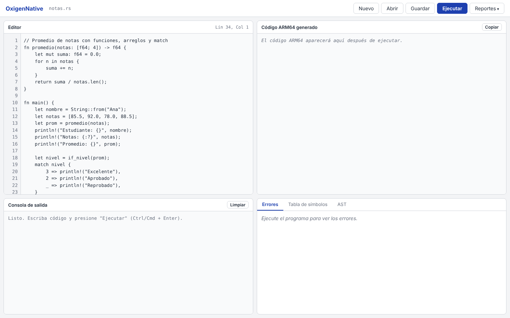
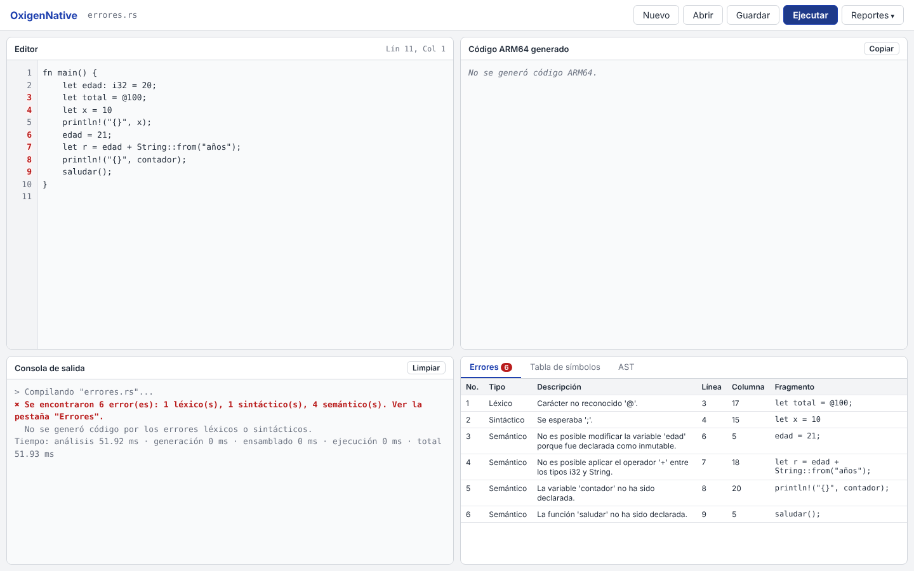
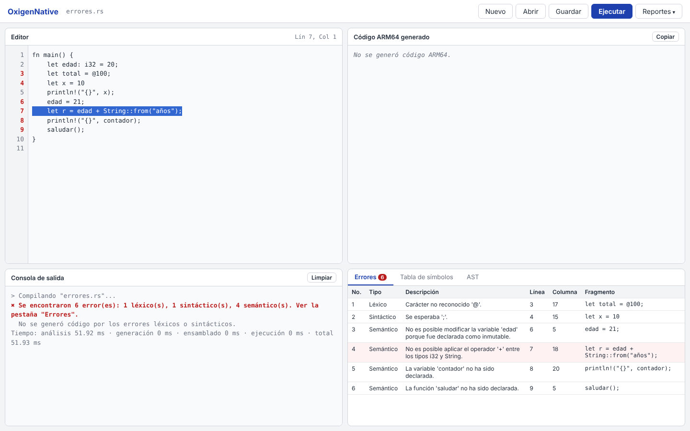
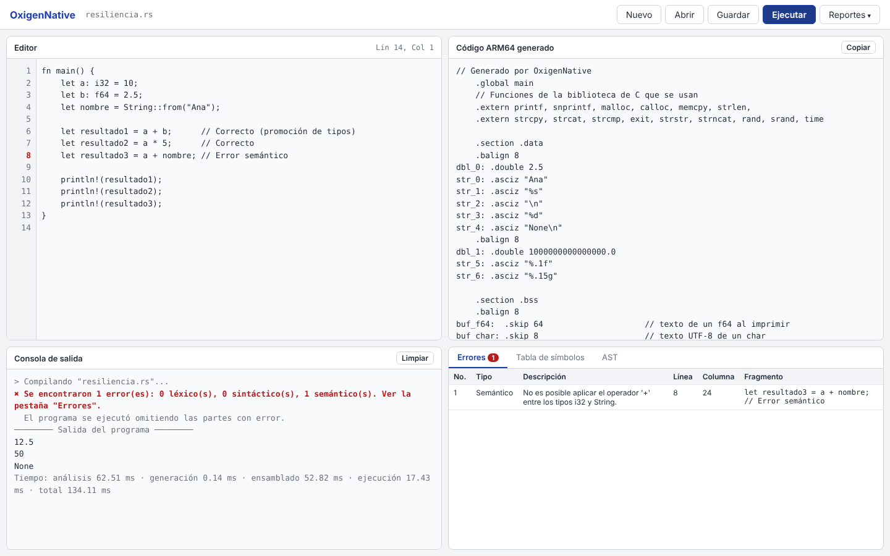
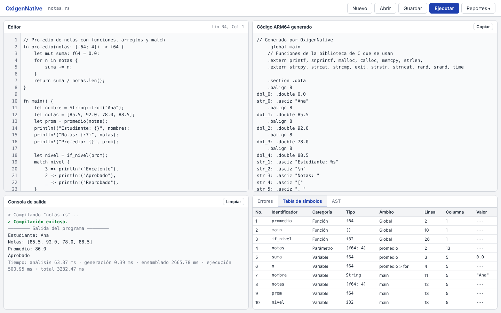
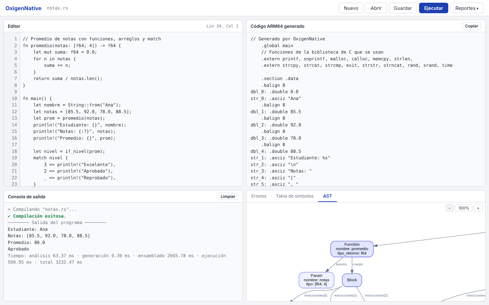
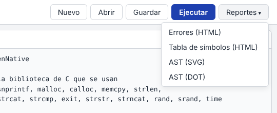
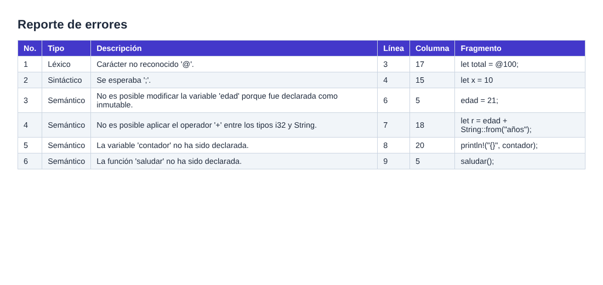
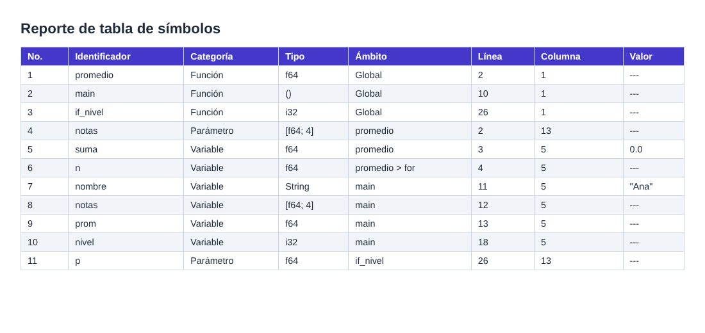

# Manual de usuario — OxigenNative

OxigenNative es un compilador que traduce programas escritos en un lenguaje parecido a Rust a código ensamblador **ARM64** y los ejecuta en **QEMU**. Todo se usa desde el navegador: se escribe el programa, se presiona **Ejecutar** y se ven la salida, el código ARM64 generado y los reportes.

---

## Contenido

1. [Requisitos](#1-requisitos)
2. [Instalación paso a paso](#2-instalación-paso-a-paso)
3. [Iniciar la aplicación](#3-iniciar-la-aplicación)
4. [La interfaz](#4-la-interfaz)
5. [Crear, abrir, editar y guardar archivos](#5-crear-abrir-editar-y-guardar-archivos)
6. [Ejecutar un programa](#6-ejecutar-un-programa)
7. [Interpretar los reportes](#7-interpretar-los-reportes)
8. [Ejemplos de sesión de uso](#8-ejemplos-de-sesión-de-uso)
9. [Uso desde la terminal](#9-uso-desde-la-terminal)
10. [Referencia rápida del lenguaje](#10-referencia-rápida-del-lenguaje)
11. [Problemas comunes](#11-problemas-comunes)

---

## 1. Requisitos

| Requisito | Detalle |
|---|---|
| Sistema operativo | **Linux** (Ubuntu 24.04 o superior). En macOS se usa una máquina virtual de Ubuntu (por ejemplo con OrbStack o UTM) |
| Python | 3.10 o superior |
| Paquetes del sistema | `build-essential`, `qemu-user`, `graphviz`, `git` (y `gcc-aarch64-linux-gnu` si la computadora es x86_64) |
| Paquetes de Python | `django`, `ply` (en `requirements.txt`) |
| Navegador | Cualquiera moderno (Chrome, Firefox, Safari, Edge) |

---

## 2. Instalación paso a paso

### 2.1 Preparar Linux

**macOS (Apple Silicon o Intel):** instale [OrbStack](https://orbstack.dev) (o UTM), cree una máquina Ubuntu y entre a ella:

```bash
orb create ubuntu ubuntu
orb -m ubuntu
```

**Linux:** use la terminal directamente.

### 2.2 Instalar las herramientas

En Ubuntu **ARM64** (Apple Silicon, Raspberry Pi, servidores ARM):

```bash
sudo apt update
sudo apt install -y python3 python3-venv python3-pip build-essential qemu-user graphviz git
```

En Ubuntu **x86_64** (Intel/AMD), agregue además el compilador cruzado para ARM64:

```bash
sudo apt install -y gcc-aarch64-linux-gnu
```

El compilador detecta la arquitectura solo: usa `gcc` en ARM64 y `aarch64-linux-gnu-gcc` en x86_64.

### 2.3 Descargar el proyecto

```bash
git clone https://github.com/Vasquez005/OLC2_N_P2_2S2026_202401451.git
cd OLC2_N_P2_2S2026_202401451
```

### 2.4 Crear el entorno de Python e instalar dependencias

```bash
python3 -m venv venv
source venv/bin/activate
pip install -r requirements.txt
```

> Cada vez que abra una terminal nueva, active el entorno con `source venv/bin/activate` antes de usar el proyecto.

### 2.5 Comprobar la instalación

```bash
python compilar.py docs/ejemplos/cuadrado.rs
```

Debe mostrar:

```
========== Salida ==========
x = 16
```

---

## 3. Iniciar la aplicación

```bash
cd backend
python manage.py runserver 0.0.0.0:8000
```

Abra en el navegador: **http://localhost:8000**

Para detener el servidor, presione `Ctrl + C` en la terminal.

> En macOS con OrbStack, `localhost:8000` funciona directamente desde el navegador del Mac.

---

## 4. La interfaz



La pantalla tiene una barra de herramientas y cuatro áreas:

| Área | Ubicación | Para qué sirve |
|---|---|---|
| **Barra de herramientas** | Arriba | Nombre del archivo actual y los botones **Nuevo**, **Abrir**, **Guardar**, **Ejecutar** y **Reportes** |
| **Editor** | Arriba a la izquierda | Donde se escribe el programa. Tiene números de línea y muestra la posición del cursor (`Lín 4, Col 1`) |
| **Código ARM64 generado** | Arriba a la derecha | El ensamblador que produjo el compilador. Es exactamente el mismo que ejecuta QEMU |
| **Consola de salida** | Abajo a la izquierda | Estado de la compilación, lo que imprime el programa y los tiempos |
| **Reportes** | Abajo a la derecha | Pestañas **Errores**, **Tabla de símbolos** y **AST** |

Junto al nombre del archivo aparece un punto (`•`) cuando hay cambios sin guardar.

---

## 5. Crear, abrir, editar y guardar archivos

| Acción | Cómo |
|---|---|
| **Crear** un archivo nuevo | Botón **Nuevo**. Si hay cambios sin guardar, pide confirmación. El editor queda con un `fn main() { }` vacío |
| **Abrir** un archivo | Botón **Abrir** y elegir un archivo `.rs` (o `.txt`) de la computadora |
| **Editar** | Escribir en el editor. **Tab** inserta 4 espacios y **Enter** conserva la sangría de la línea |
| **Guardar** | Botón **Guardar** o **Ctrl + S** (**Cmd + S** en Mac). Pide el nombre y descarga el archivo |
| **Ejecutar** | Botón **Ejecutar** o **Ctrl + Enter** (**Cmd + Enter** en Mac) |

> Si se recarga la página, el código no se pierde: el navegador guarda un borrador automáticamente.

---

## 6. Ejecutar un programa

Presione **Ejecutar**. El código se envía al servidor, que lo analiza, genera ARM64, lo ensambla y lo ejecuta en QEMU.


### 6.1 La consola de salida

```
> Compilando "notas.rs"...
✔ Compilación exitosa.
──────── Salida del programa ────────
Estudiante: Ana
Notas: [85.5, 92.0, 78.0, 88.5]
Promedio: 86.0
Aprobado
Tiempo: análisis 63 ms · generación 0.4 ms · ensamblado 44 ms · ejecución 15 ms · total 123 ms
```

> Los tiempos varían según la computadora. La primera ejecución después de iniciar el servidor suele tardar más en el ensamblado.

| Línea | Significado |
|---|---|
| `✔ Compilación exitosa.` (verde) | No hubo errores |
| `✖ Se encontraron N error(es)...` (rojo) | Cuántos errores hubo de cada tipo; el detalle está en la pestaña **Errores** |
| `El programa se ejecutó omitiendo las partes con error.` | Hubo solo errores **semánticos**: el programa se ejecutó igual y lo inválido se omitió o se imprimió como `None` |
| `No se generó código por los errores léxicos o sintácticos.` | Con errores léxicos o sintácticos el programa no se ejecuta |
| Salida del programa | Lo que imprimieron los `println!` |
| `[Error de ejecución] ...` | El programa falló al ejecutarse (por ejemplo, un índice fuera de los límites del arreglo) |
| `La ejecución superó 5 s (¿ciclo infinito?).` | El programa se detuvo por tardar demasiado; lo que imprimió antes sí se muestra |
| `Tiempo:` | Milisegundos de cada etapa |

### 6.2 El código ARM64

El panel derecho muestra el archivo `.s` completo, con comentarios que indican a qué línea del programa corresponde cada parte (`// if (línea 7)`). El botón **Copiar** lo copia al portapapeles.

---

## 7. Interpretar los reportes

### 7.1 Errores



La pestaña **Errores** muestra un número rojo con la cantidad de errores. Cada fila tiene:

| Columna | Significado |
|---|---|
| No. | Número del error |
| Tipo | **Léxico** (un carácter que no pertenece al lenguaje), **Sintáctico** (el programa está mal escrito, por ejemplo falta un `;`) o **Semántico** (está bien escrito pero no tiene sentido, por ejemplo sumar un número con un texto) |
| Descripción | Qué está mal |
| Línea y Columna | Dónde ocurrió |
| Fragmento | La línea de código donde está el error |

- Las líneas con error se marcan **en rojo** en los números del editor.
- **Al hacer clic en un error**, el editor salta a esa línea y la selecciona:



El compilador reporta **todos** los errores de una vez, no solo el primero. Por ejemplo, si falta un `;`, lo indica y sigue revisando el resto del programa.

**Resiliencia:** si solo hay errores semánticos, el programa se ejecuta igual y las partes inválidas se omiten o se imprimen como `None`:



### 7.2 Tabla de símbolos



Lista cada nombre declarado en el programa:

| Columna | Significado |
|---|---|
| Identificador | El nombre |
| Categoría | **Función**, **Variable** o **Parámetro** |
| Tipo | `i32`, `f64`, `bool`, `char`, `String`, arreglos como `[f64; 4]`. Para las funciones es el tipo que retornan; `()` significa que no retornan nada |
| Ámbito | Dónde existe: `Global` para las funciones; `main`, `promedio`, o bloques internos como `promedio > for` o `main > if` |
| Línea y Columna | Dónde se declaró |
| Valor | El valor inicial si es una constante conocida; `---` si se calcula al ejecutar |

> Si una variable se declara dos veces con el mismo nombre (sombreado), aparecen las dos filas: son variables distintas.

### 7.3 AST (árbol de sintaxis abstracta)



Muestra la estructura del programa como un árbol, dibujado con Graphviz:

- Cada caja es una parte del programa (`Function`, `VarDecl`, `If`, `BinaryOp`...) con sus datos.
- Las flechas indican qué parte contiene a cuál; la etiqueta dice el rol (`condicion`, `izq`, `der`, `instrucciones[0]`...).
- `⟶ tipo` es el tipo que calculó el compilador para esa expresión.
- **Colores:** azul para la estructura del programa (`Program`, `Function`, `Block`), lila claro para las instrucciones, verde para las expresiones y **rojo para lo que tiene un error semántico**.
- Los botones **−**, **100%** y **+** cambian el tamaño; con las barras de desplazamiento se recorre el árbol.

### 7.4 Reportes como archivos

El menú **Reportes** de la barra abre los reportes del último programa ejecutado en una pestaña nueva:



| Opción | Archivo |
|---|---|
| Errores (HTML) | Tabla de errores |
| Tabla de símbolos (HTML) | Tabla de símbolos |
| AST (SVG) | Imagen del árbol |
| AST (DOT) | Código fuente Graphviz del árbol |





Los mismos archivos se guardan automáticamente en la carpeta `build/reportes/` del proyecto.

---

## 8. Ejemplos de sesión de uso

### 8.1 Programa correcto

1. Presione **Nuevo**.
2. Escriba:

   ```rust
   fn factorial(n: i32) -> i32 {
       if n <= 1 {
           return 1;
       }
       return n * factorial(n - 1);
   }

   fn main() {
       for i in 1..=5 {
           println!("{}! = {}", i, factorial(i));
       }
   }
   ```

3. Presione **Ejecutar**. La consola muestra:

   ```
   ✔ Compilación exitosa.
   1! = 1
   2! = 2
   3! = 6
   4! = 24
   5! = 120
   ```

4. Revise la pestaña **Tabla de símbolos**: aparecen `factorial` (Función, `i32`), `main`, el parámetro `n` y la variable `i` (ámbito `main > for`).
5. Presione **Guardar** y escriba `factorial.rs`.

### 8.2 Corregir errores

1. Abra o escriba un programa con errores:

   ```rust
   fn main() {
       let edad: i32 = 20;
       let x = 10
       edad = 21;
   }
   ```

2. Presione **Ejecutar**. La pestaña **Errores** muestra:
   - `Sintáctico`, línea 3: `Se esperaba ';'.`
   - `Semántico`, línea 4: `No es posible modificar la variable 'edad' porque fue declarada como inmutable.`
3. Haga clic en cada error para ir a la línea. Corrija: agregue el `;` y cambie `let edad` por `let mut edad`.
4. Presione **Ejecutar** otra vez: `✔ Compilación exitosa.`

---

## 9. Uso desde la terminal

También se puede compilar sin la interfaz (desde la raíz del proyecto, con el entorno activado):

```bash
python compilar.py programa.rs              # errores y salida del programa
python compilar.py programa.rs --asm        # además, el código ARM64
python compilar.py programa.rs --reportes   # además, genera los reportes en build/reportes/
python tests/correr_todo.py                 # corre todos los programas de prueba
```

El último ensamblador generado queda en `build/programa.s`. Para ensamblarlo y ejecutarlo a mano:

```bash
gcc -static build/programa.s -o build/programa      # en x86_64: aarch64-linux-gnu-gcc
qemu-aarch64 build/programa
```

---

## 10. Referencia rápida del lenguaje

```rust
// Comentario de línea          /* comentario de bloque */

fn main() {                                   // todo programa empieza en main
    // Variables (inmutables salvo con mut)
    let edad: i32 = 20;                       // tipo explícito
    let mut contador = 0;                     // tipo inferido, mutable
    let pi: f64 = 3.1416;
    let activo: bool = true;
    let letra: char = 'ñ';
    let nombre = String::from("Ana");
    let vacio: i32;                           // valor por defecto: 0

    // Operadores:  + - * / %   == != < > <= >=   && || !   = += -= *= /= %=
    contador += 1;

    // Impresión
    println!("Hola {}, tienes {} años", nombre, edad);
    println!(edad);

    // Control de flujo
    if edad >= 18 { println!("mayor"); } else if edad > 12 { println!("adolescente"); } else { println!("niño"); }
    while contador < 3 { contador += 1; }
    for i in 0..3 { println!("{}", i); }      // 0..=3 incluye el 3
    'externo: loop { break 'externo; }
    match edad {
        18 => println!("recién cumplidos"),
        20 => { println!("veinte"); }
        _ => println!("otra edad"),
    }

    // Arreglos
    let mut numeros = [10, 20, 30];
    let matriz: [[i32; 2]; 2] = [[1, 2], [3, 4]];
    numeros[0] = 5;
    println!("{:?} {} {}", numeros, matriz[1][0], numeros.len());
    let parte = &numeros[0..2];

    // Funciones embebidas
    let texto = String::from("Hola Mundo");
    println!("{} {} {}", texto.len(), texto.contains("Mundo"), texto.to_uppercase());
    println!("{} {:?}", texto.replace("Mundo", "Rust"), texto.split(" "));
    numeros.reverse();
    println!("{} {}", typeof(pi), random(1, 10));
}

fn sumar(a: i32, b: i32) -> i32 {             // función con retorno
    return a + b;
}
```

| Tipo | Ejemplo | Valor por defecto |
|---|---|---|
| `i32` | `42` | `0` |
| `f64` | `3.14` | `0.0` |
| `bool` | `true` | `false` |
| `char` | `'a'` | — |
| `String` | `String::from("hola")` | `""` |
| `[T; N]` | `[1, 2, 3]` | arreglo de ceros |

---

## 11. Problemas comunes

| Problema | Solución |
|---|---|
| `No se pudo conectar con el servidor` en la consola | El servidor no está corriendo: ejecute `python manage.py runserver 0.0.0.0:8000` dentro de `backend/` |
| `No se encontró 'gcc'` o `'aarch64-linux-gnu-gcc'` | Instale `build-essential` (ARM64) o `gcc-aarch64-linux-gnu` (x86_64) |
| `No se encontró 'qemu-aarch64'` | `sudo apt install qemu-user` |
| `No se pudo generar el AST` | Instale Graphviz: `sudo apt install graphviz` |
| `ModuleNotFoundError: No module named 'django'` o `'ply'` | Active el entorno: `source venv/bin/activate` |
| `La ejecución superó 5 s` | El programa tiene un ciclo que no termina; revise la condición o agregue un `break` |
| `Índice fuera de los límites del arreglo` | Se usó una posición que no existe; los índices van de `0` a `largo - 1` |
| La página no carga en macOS | Verifique que la máquina de OrbStack esté encendida y que el servidor use `0.0.0.0:8000` |
